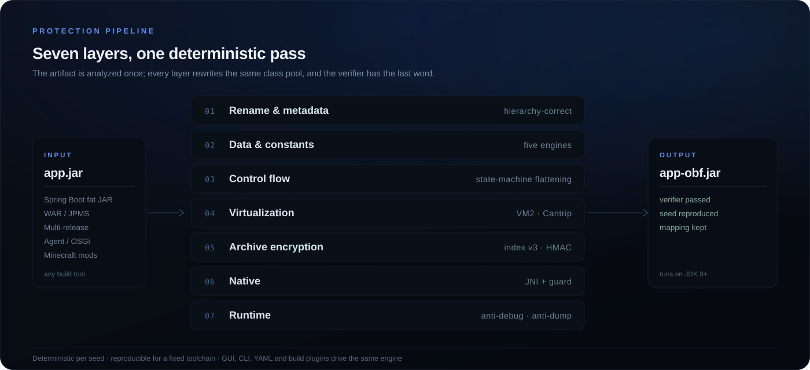
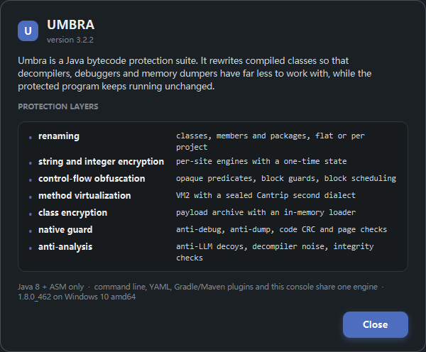

<div align="center">


# Umbra

**Java bytecode protection, without compromise.**

[](#requirements)
[](#requirements)
[](LICENSE)
[](#desktop-gui)
[](https://github.com/Deobff/umbra/actions/workflows/release.yml)

Umbra is a layout-aware Java bytecode protection suite: renaming, multi-engine
string encryption, control-flow hardening, VM virtualization, native code
generation, whole-archive encryption and runtime anti-analysis in one
self-contained Java 8 JAR — with a JavaFX desktop console, a scriptable CLI,
YAML configuration and Gradle/Maven plugins.

[Download latest release](https://github.com/Deobff/umbra/releases/latest) ·
[Quick start](#quick-start) · [Features](#features) · [Compatibility](#compatibility) · [Build](#build-from-source)

</div>

---

## Why Umbra

Most Java obfuscators optimize for one layer. Umbra is built as a pipeline that
understands the **shape of the artifact** (Spring Boot fat JAR, executable WAR,
multi-release JAR, JPMS module, signed JAR, Java agent, OSGi bundle, Minecraft
mod), so protection layers that depend on a working class loader and manifest
do not break the application.

Mod containers, `module-info`, nested libraries and manifest entry points are all
part of that analysis, so the result still loads. Everything is deterministic per
seed, reproducible for a fixed toolchain, and can be driven from the GUI, CLI,
YAML or a build plugin.



---

## Screenshots

<div align="center">
<table>
<tr>
<td width="64%"></td>
<td width="36%"></td>
</tr>
<tr>
<td align="center"><sub>Protection console — configuration rail, Options / Command / Output views, live targets band</sub></td>
<td align="center"><sub>Protection layers and the exact engine/jar paths in use</sub></td>
</tr>
</table>

<sub>13 groups / 109 controls · presets load the engine's own effective values · numeric values use animated sliders</sub>
</div>

---

## Features

### Archive compatibility
- Spring Boot 2/3 fat JARs and executable WARs, plain WARs, multi-release JARs,
  modular (JPMS) JARs, signed JARs, Java agents and OSGi bundles.
- Preserves `BOOT-INF/classes`, `WEB-INF/classes`, nested libraries (including
  STORED compression), `module-info`, `Multi-Release`, `spring.factories`,
  `AutoConfiguration.imports`, ServiceLoader metadata and framework manifests.
- Root loader classes of a fat JAR are never renamed or rewritten, `Main-Class`
  / `Start-Class` are remapped, duplicate entries are resolved deterministically.
- `--inspect` / `--inspect-json` compatibility report; post-run
  `--compat-report`; output verifier loads every emitted class.

### Names and metadata
- Hierarchy-correct class/method/field renaming, package repackaging,
  dictionary and length control, mapping export/import, stable incremental
  mappings and mapping diff/trace.
- Reflection-aware keeps, annotation rules, framework presets and Minecraft
  adaptation; optional public API preservation.
- Debug metadata erasure, member shuffling, junk members and watermarking.

### Data and control flow
- Per-site string encryption with **XOR / RC4 / ChaCha20 / AES-256-CTR /
  Speck**, randomized per-class site indices, per-artifact domain salt,
  per-class keys, split payloads, optional `invokedynamic` bootstrap,
  stack-trace hiding, decrypt-and-wipe and encrypt-all. Plaintext caching is
  opt-in and off by default.
- Integer/long constant encryption, MBA arithmetic rewriting.
- Opaque predicates, branch inversion, junk/dead blocks, independent-block
  transposition, bogus exception ranges, state-machine flattening with shuffled
  dispatchers, synthetic exception handlers, method splitting and wrapper
  indirection.

### Virtualization
- Custom stack-machine interpreter for eligible methods.
- **VM2**: rolling-key opcode encoding, superinstruction fusion, encrypted split
  payloads, try/catch dispatch, per-thread state, nested dispatch,
  `invokedynamic` bridges and constructor bodies.
- Optional **Cantrip** second virtualization layer.

### Native and archive protection
- JNI native compilation for eligible methods, embedded native library,
  anti-dump fingerprint, native backfill verification and keyed challenge, with
  a graceful Java fallback on every failure path.
- Whole-JAR class/resource encryption (index v3) with a plaintext bootstrap
  loader, sample-bound master key, per-entry nonce KDF, HMAC-keyed
  class/resource/loader digests, anti-dump checks, sampled payload watchdog and
  a minimized manifest.

### Runtime anti-analysis
- Unified Java runtime guard: agent/instrumentation arguments, dynamic attach,
  JDWP, JMX, environment markers, heap-dump flags, timing anomalies and a
  randomized watchdog.
- Native guard: debugger APIs, PEB, debug registers, Frida modules/pipes/
  threads/env, module integrity, memory-breakpoint scan, code-section sampling,
  timing, optional handle anti-dump and Linux `/proc` checks.
- Detection runs at entry points, before integrity checks and before every
  encrypted class decrypt; sticky fail-closed state, plaintext/key wiping and
  silent refusals with no self-identifying stack traces.

### Decompiler / analysis hardening
- Type confusion through `Object`/`Object[]` carriers.
- Decompiler/AI noise levels 1–4: unknown attributes, contradictory debug
  tables, bogus signatures, phantom inner classes, class-level `Code` trap and
  `EnclosingMethod`/`SourceDebugExtension`/`MethodParameters` traps —
  JVM-legal and verifier-safe.
- `invokedynamic` reference hiding, reflection analysis and optional reflection
  seal, anti-LLM decoy methods and wrapper layers.
- **Nocturne** polymorphic method shadows with ARX-encoded parameters and
  runtime-selected equivalent bodies.

### Tooling
- One executable engine JAR plus an optional JavaFX console JAR: GUI, CLI and
  YAML all drive the same engine.
- Deterministic seeds, presets (`light`, `balanced`, `aggressive`, `maximum`,
  `nocturne`, framework presets) and per-option overrides through `--set`.
- HTML/JSON audit reports, mapping validation, watermark tracing, JVM verifier.
- Gradle plugin `io.umbra` (`umbraProtect`) and Maven plugin
  `io.umbra:umbra-maven-plugin` (`umbra:protect`).
- Automatic Minecraft mod-container adaptation: Fabric/Quilt, Forge
  legacy/modern, NeoForge, mixins, access wideners/transformers and coremods.

---

## Quick start

### Requirements

| | |
|---|---|
| Run Umbra | JDK 8 or newer |
| Protected output | Keeps the input class-file version; runs on JDK 8+ |
| Desktop console | A JDK 8 that ships JavaFX (`JFX_JAVA_HOME`, optional) |
| Native guard/code | Optional C toolchain on Windows (graceful Java fallback elsewhere) |
| Build source | JDK 8, PowerShell (Windows) |

### Desktop GUI

```bat
Umbra.cmd               :: JavaFX protection console
umbra-fx.cmd            :: same console, explicit launcher
java -jar dist\umbra.jar --gui
```

The engine jar stays JavaFX-free: `java -jar umbra.jar` looks for
`umbra-gui-fx.jar` next to itself and starts the console as a child process,
printing the command-line help when either the console jar or a JavaFX-capable
JVM is missing. The console draws its own window chrome and groups every
switch and value the engine accepts into 13 sections (109 controls) behind
Options / Command / Output views, with a targets band, a preset selector that
loads the engine's effective values, live log, progress, cancel and an About
window.

### CLI

```bat
:: balanced protection with verification
java -jar dist\umbra.jar -i app.jar -o app-obf.jar --preset balanced --verify

:: maximum protection: encryption + VM2 + native guard, etc.
java -jar dist\umbra.jar -i app.jar -o app-obf.jar --preset maximum --verify --seed 23303

:: YAML configuration
java -jar dist\umbra.jar -c umbra.example.yml

:: inspect an artifact before protecting it (read-only)
java -jar dist\umbra.jar -i app.jar --inspect
java -jar dist\umbra.jar -i app.jar --inspect-json inspection.json
```

Advanced modules are reached through `--set`:

```bat
java -jar dist\umbra.jar -i app.jar -o app-obf.jar ^
  --set typeConfusion.enabled=true ^
  --set string.engine=auto --set string.wipe=true ^
  --set vm2.enabled=true --set vm2.fusion=true ^
  --set nocturne.enabled=true ^
  --set classEncryption.enabled=true --set classEncryption.resources=true ^
  --set integrity.enabled=true ^
  --set native.enabled=true --set native.compiler=E:/mingw64/bin/gcc.exe
```

Every key is documented in [docs/OPTIONS.md](docs/OPTIONS.md). Additional flags
include `--keep`, `--flatten`, `--virtualize`, `--anti-llm`, `--compat-report`,
`--mapping`, `--report`/`--report-json`, `--input-mapping`,
`--trace-watermark`, `--diff-mapping`, `--dry-run`, `--license*`.

### Presets

| Preset | What it is for |
|---|---|
| `light` | Fast rename + string/integer encryption, minimal behavioral change |
| `balanced` | Rename, strings, flow, exceptions, VM2, anti-LLM, class encryption |
| `aggressive` | Balanced plus aggressive flow, integrity and anti-debug |
| `maximum` | Aggressive plus type confusion, reference obfuscation and full metadata/noise |
| `nocturne` | Nocturne polymorphic shadows, VM/flow still available |
| framework presets | `library`, `spring-boot`, `jackson`, `service-loader`, `micronaut` |

### YAML

```yaml
input: "app.jar"
output: "app-obf.jar"
preset: "balanced"
methodVirtualization:
  enabled: true
string:
  strength: 3
```

```bat
java -jar dist\umbra.jar -c umbra.yml --dry-run   :: print the effective settings
```

### Minecraft mods

Mod containers are detected and adapted automatically (default on). Entry
classes/methods, `@Mod` classes, Mixin classes/targets/configs and referenced
target members are kept; mixin/target method bodies are exempted; conflicting
protections are downgraded automatically.

```bat
java -jar dist\umbra.jar -i mymod.jar -o mymod-obf.jar --verify
java -jar dist\umbra.jar -i mymod.jar -o mymod-obf.jar --set minecraft.forceVmp=true
java -jar dist\umbra.jar -i mymod.jar -o mymod-obf.jar --set minecraft.enabled=false
```

Details: [docs/MINECRAFT.md](docs/MINECRAFT.md).

### Gradle / Maven

The plugins under `plugins/` run the Umbra CLI as part of a normal build and
fail the build on any protection error:

```groovy
// build.gradle
plugins { id 'io.umbra' version '3.0.0' }
umbraProtect {
    toolJar = file("tools/umbra.jar")
    preset  = "balanced"
    verify  = true
}
```

```xml
<!-- pom.xml -->
<plugin>
  <groupId>io.umbra</groupId>
  <artifactId>umbra-maven-plugin</artifactId>
  <version>3.0.0</version>
  <executions><execution><goals><goal>protect</goal></goals></execution></executions>
</plugin>
```

Full parameter tables, CI examples and troubleshooting: [plugins/README.md](plugins/README.md).

---

## Compatibility

| Input | Status |
|---|---|
| Plain JAR / executable JAR | ✅ |
| Spring Boot 2.x / 3.x fat JAR | ✅ (nested libs preserved, STORED kept) |
| Executable WAR | ✅ |
| Plain WAR (external container) | ✅ with layout notes; root-only guards may need re-verification in the container |
| Multi-release JAR | ✅ preserved (`layout.multiRelease=preserve`, default) or flattened |
| JPMS modular JAR | ✅ `module-info` remapped (`layout.moduleInfo=auto\|keep\|drop`) |
| Signed JAR | ✅ signatures stripped, artifact re-verified |
| Java agent | ✅ `Premain-Class` / `Agent-Class` protected |
| OSGi bundle | ✅ `Bundle-Activator` remapped |
| Minecraft Fabric/Quilt/Forge/NeoForge | ✅ automatic adaptation and mixin keeps |
| Gradle Shadow / Maven Shade | ✅ |

Whole-archive class encryption, the startup integrity seal and the native guard
launcher are flat-JAR constructs; on nested layouts they are skipped with an
explicit warning instead of producing a broken archive. See
[docs/COMPATIBILITY.md](docs/COMPATIBILITY.md) for the layout model and the
tested input matrix.

Protected artifacts have been exercised on JDK 8, 21 and 26; the tool itself
runs on JDK 8.

---

## Security model

Umbra raises the cost of static and dynamic analysis; it does not claim
"unbreakable". The design is layered and fail-closed:

- **Encrypted archive**: sample-bound master key, per-entry nonce in the KDF,
  HMAC-keyed class/resource/loader digests, integrity level ≥ 2 by default,
  sampled watchdog with fail-closed heartbeat, silent refusals with no
  self-identifying stack traces.
- **Runtime guard**: Java + native detection, dynamic-attach watcher, heap-dump
  flags, host/instrumentation markers and timing checks.
- **Anti-dump**: per-class digest verification before define, key/plaintext
  wiping and native library fingerprint/backfill checks.

Known limitations: Java-only dynamic attach detection on Windows is
best-effort (the native guard is the reliable path), mapped DLLs stay on disk
until the next run, and no obfuscator stops a determined native-level reverse
engineer. Encrypted archives use index v3; rebuild archives protected by an
earlier 3.x line.

`demo-obf.jar` is an example of an Umbra-encrypted demo application. It is a
local test artifact (no network, no persistence); only run binaries you trust.

---

## Build from source

```bat
:: Windows (JDK 8 on PATH or JAVA_HOME)
build.cmd                      :: compile + self tests + dist\umbra.jar
build.cmd -Task compile        :: fast compile
build.cmd -Task test           :: compile + self tests
build.cmd -Task dist           :: executable jar
build.cmd -Task package        :: executable jar + distribution zip + SHA-256 sums
build.cmd -Task gui            :: launch the JavaFX console
```

Linux/macOS can use `build.ps1 -Task dist` with PowerShell 7 and a JDK 8. The
build has no runtime dependency beyond the vendored ASM under `lib/`.

Releases are produced by CI on any `v*` tag: the workflow builds
`dist\umbra.jar`, packages `dist\umbra-<version>.zip` with the launchers, GUI
jar, example config and docs, writes `dist\SHA256SUMS`, and publishes them to
[Releases](https://github.com/Deobff/umbra/releases).

---

## Repository layout

```text
build.ps1 / build.cmd / Umbra.cmd / umbra-cli.cmd / umbra-fx.cmd
lib/                           vendored ASM 9.11
src/main/java/io/umbra/        annotations, cli, core (api/config/compat/engine/
                               model/pass/runtime/rules/util), gui (control model)
gui-fx/                        JavaFX console sources and umbra-gui-fx.jar
src/test/java/io/umbra/tests/  self-test suites (plain main, JDK 8)
plugins/                       Gradle + Maven plugin sources, samples, QA runner
demo/  qa/  docs/  dist/       demo sources, QA harnesses, docs, artifacts
assets/                        README visuals
demo-obf.jar                   example protected demo
.github/workflows/             release automation (tag v*)
```

Deep dives: [architecture](docs/ARCHITECTURE.md) for the pass pipeline and core
APIs, [hardening](docs/HARDENING.md) for the runtime guard, the
[latest hardening report](docs/REPORT-3.2.1.md), [feature report](docs/REPORT-3.2.md),
[earlier release report](docs/REPORT-3.1.md) with its
[audit table](docs/AUDIT-3.1.md), and the
[capability matrix](docs/REFERENCE-MATRIX.md) behind the engine.

---

## 中文简介

Umbra 是一套面向 Java 字节码的混淆/加固工具：兼容 Spring Boot fat JAR、WAR、
多版本 JAR、JPMS、签名 JAR、agent、OSGi 与 Minecraft 模组；提供重命名、
多引擎字符串加密、控制流混淆、VM2 虚拟化、原生 JNI、整包类加密、运行时反调试
与反 dump，并附带 JavaFX 桌面控制台、CLI、YAML、Gradle/Maven 插件。
每个模式都集中在 13 个分组、109 个控件里细调，数值项使用带缓动的滑块，
预设会直接读取引擎的真实生效值。发布包见
[Releases](https://github.com/Deobff/umbra/releases)。

---

## Safety and scope

Umbra is a defensive engineering tool for protecting your own software. Only
apply it to code you own or are authorized to modify. Some techniques (native
code, encrypted loaders, anti-debug) are intentionally detectable by endpoint
security products; validate licensing, distribution and legal requirements
before shipping protected artifacts.

---

## License

[MIT](LICENSE) · Copyright (c) 2026 YZT
