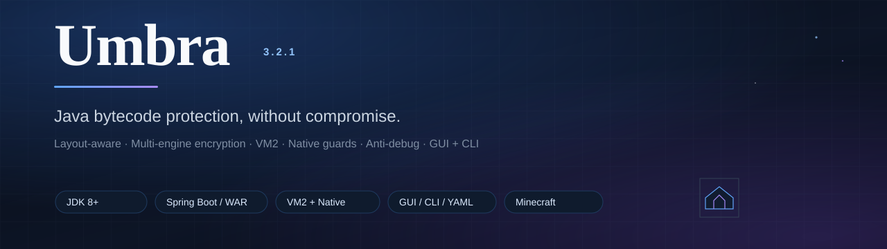
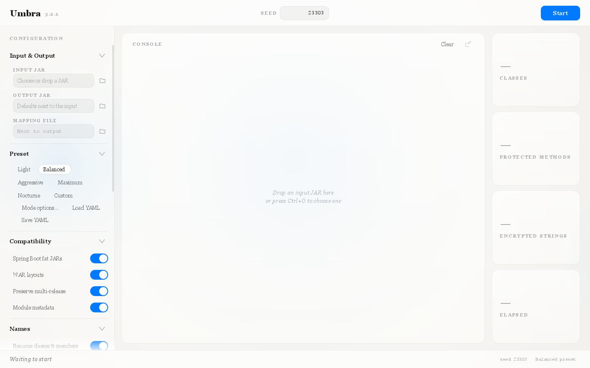
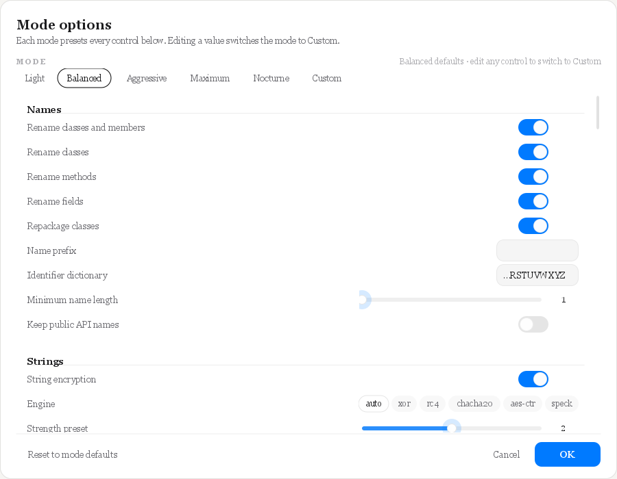
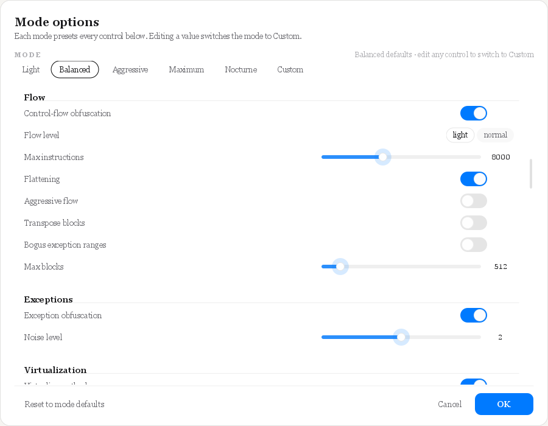

<div align="center">



# Umbra

**Java bytecode protection, without compromise.**

[](https://github.com/Deobff/umbra/releases)
[](#requirements)
[](#requirements)
[](LICENSE)
[](#desktop-gui)

Umbra is a layout-aware Java bytecode protection suite. It combines renaming,
multi-engine string encryption, control-flow hardening, VM virtualization,
native code generation, archive encryption and runtime anti-analysis in one
self-contained Java 8 JAR — with a desktop GUI, a scriptable CLI, YAML
configuration and Gradle/Maven plugins.

[Download latest release](https://github.com/Deobff/umbra/releases/latest) ·
[Quick start](#quick-start) · [Features](#features) · [Compatibility](#compatibility) · [Build](#build-from-source)

</div>

---

## Why Umbra

Most Java obfuscators optimize for one layer. Umbra is built as a pipeline that
understands the **shape of the artifact** (Spring Boot fat JAR, executable WAR,
multi-release JAR, JPMS module, signed JAR, Java agent, OSGi bundle, Minecraft
mod), so protection layers that depend on a working class loader and manifest
do not break the application.

```text
JAR/WAR ──▶ layout analysis ──▶ hierarchy-aware rename ──▶ data/flow/VM/native passes
        ──▶ class & resource encryption + runtime guard ──▶ verifier ──▶ protected artifact
```

Everything is deterministic per seed, reproducible for a fixed seed and
toolchain, and can be driven from the GUI, CLI, YAML or a build plugin.

---

## Screenshots

<div align="center">
<table>
<tr>
<td width="62%"></td>
<td width="38%"></td>
</tr>
<tr>
<td align="center"><sub>Desktop GUI — presets, live console, statistics and YAML round-trip</sub></td>
<td align="center"><sub>Every mode exposes detailed options; numeric values use animated sliders</sub></td>
</tr>
</table>



<sub>Mode options sheet — 12 groups / 111 controls, 25 animated sliders</sub>
</div>

---

## Features

### Archive compatibility
- Spring Boot 2/3 fat JARs and executable WARs, plain WARs, multi-release JARs,
  modular (JPMS) JARs, signed JARs, Java agents and OSGi bundles.
- Preserves `BOOT-INF/classes`, `WEB-INF/classes`, nested libraries (including
  STORED compression), `module-info`, `Multi-Release`, `spring.factories`,
  `AutoConfiguration.imports`, ServiceLoader metadata and framework manifests.
- `--inspect` / `--inspect-json` compatibility report; post-run
  `--compat-report`; output verifier loads every emitted class.

### Names and metadata
- Hierarchy-correct class/method/field renaming, package repackaging,
  dictionary and length control, mapping export/import, incremental builds.
- Reflection-aware keeps, annotation rules, framework presets and Minecraft
  adaptation; optional public API preservation.
- Debug metadata erasure, member shuffling, junk members and watermarking.

### Data and control flow
- Per-site string encryption with **XOR / RC4 / ChaCha20 / AES-256-CTR /
  Speck**, randomized per-class site indices, per-artifact domain salt,
  split payloads, optional `invokedynamic`, stack-trace hiding, decrypt-and-wipe
  and encrypt-all. Plaintext caching is opt-in and off by default.
- Integer/long constant encryption, MBA arithmetic rewriting.
- Opaque predicates, branch inversion, junk/dead blocks, block transposition,
  bogus exception ranges, synthetic exception handlers, state-machine
  flattening, method splitting and wrapper indirection.

### Virtualization
- Custom stack-machine interpreter for eligible methods.
- **VM2**: rolling-key opcode encoding, superinstruction fusion, encrypted split
  payloads, try/catch dispatch, per-thread state, nested dispatch,
  `invokedynamic` bridges and constructor bodies.
- Optional **Cantrip** second virtualization layer.

### Native and archive protection
- JNI native compilation for eligible methods, embedded native library,
  anti-dump fingerprint, native backfill verification and keyed challenge.
- Whole-JAR class/resource encryption with a plaintext bootstrap loader,
  sample-bound master key, per-entry nonce KDF, HMAC-keyed integrity digests,
  anti-dump checks and a sampled payload watchdog.

### Runtime anti-analysis
- Java runtime guard: JVM/agent arguments, dynamic attach, JDWP, JMX,
  environment markers, heap-dump flags, instrumentation, timing anomalies and a
  randomized watchdog.
- Native guard: debugger APIs, PEB, debug registers, Frida modules/pipes/
  threads/env, module integrity, memory-breakpoint scan, code-section sampling,
  timing, optional handle anti-dump and Linux `/proc` checks.
- Sticky fail-closed state; actions `throw`, `exit`, `corrupt` or `log`;
  encrypted-class refusal and buffer wiping.

### Decompiler / analysis hardening
- Type confusion through `Object`/`Object[]` carriers.
- Decompiler/AI noise levels 1–4: contradictory debug tables, bogus signatures,
  phantom inner classes and code-attribute traps.
- `invokedynamic` reference hiding, reflection gate, anti-LLM decoy methods and
  wrapper layers.
- **Nocturne** polymorphic method shadows with keyed arguments and
  runtime-selected equivalent bodies.

### Tooling
- One executable JAR: desktop **GUI**, CLI and YAML.
- Deterministic seeds, presets (`light`, `balanced`, `aggressive`, `maximum`,
  `nocturne`, framework presets) and per-option overrides.
- HTML/JSON audit reports, mapping diff/trace, watermark tracing, JVM verifier.
- Gradle plugin `io.umbra` (`umbraProtect`) and Maven plugin
  `io.umbra:umbra-maven-plugin` (`umbra:protect`).
- Automatic Minecraft mod-container adaptation: Fabric/Quilt, Forge
  legacy/modern, NeoForge, mixins, access wideners/transformers and coremods.

---

## Quick start

### Requirements

| | |
|---|---|
| Run Umbra | JDK 8 or newer |
| Protected output | Keeps the input class-file version; runs on JDK 8+ |
| Native guard/code | Optional C toolchain on Windows (graceful Java fallback elsewhere) |
| Build source | JDK 8, PowerShell (Windows) |

### Desktop GUI

```bat
java -jar umbra.jar
```

Choose an input JAR, a mode, open **Mode options…** for detailed settings, then
press **Start**. Drag-and-drop, YAML load/save, presets, live console and
statistics are built in.

### CLI

```bat
:: balanced protection with verification
java -jar umbra.jar -i app.jar -o app-obf.jar --preset balanced --verify

:: maximum protection: encryption + VM2 + native guard, etc.
java -jar umbra.jar -i app.jar -o app-obf.jar --preset maximum --verify

:: inspect an artifact before protecting it
java -jar umbra.jar --inspect app.jar
```

### Presets

| Preset | What it is for |
|---|---|
| `light` | Fast rename + string/integer encryption, minimal behavioral change |
| `balanced` | Rename, strings, flow, exceptions, VM2, anti-LLM, class encryption |
| `aggressive` | Balanced plus aggressive flow, integrity and anti-debug |
| `maximum` | Aggressive plus type confusion, reference obfuscation and full metadata/noise |
| `nocturne` | Nocturne polymorphic shadows, VM/flow still available |
| framework presets | `library`, `spring-boot`, `jackson`, `service-loader`, `micronaut` |

### YAML

```yaml
input: "app.jar"
output: "app-obf.jar"
preset: "balanced"
methodVirtualization:
  enabled: true
string:
  strength: 3
```

```bat
java -jar umbra.jar -c umbra.yml
```

---

## Compatibility

| Input | Status |
|---|---|
| Plain JAR / executable JAR | ✅ |
| Spring Boot 2.x / 3.x fat JAR | ✅ (nested libs preserved, STORED kept) |
| Executable WAR | ✅ |
| Plain WAR (external container) | ✅ with layout notes; root-only guards may need re-verification in the container |
| Multi-release JAR | ✅ preserved or flattened |
| JPMS modular JAR | ✅ `module-info` remapped |
| Signed JAR | ✅ signatures stripped, artifact re-verified |
| Java agent | ✅ `Premain-Class` / `Agent-Class` protected |
| OSGi bundle | ✅ `Bundle-Activator` remapped |
| Minecraft Fabric/Quilt/Forge/NeoForge | ✅ automatic adaptation and mixin keeps |
| Gradle Shadow / Maven Shade | ✅ |

Protected artifacts have been exercised on JDK 8, 21 and 26; the tool itself
runs on JDK 8.

---

## Security model

Umbra raises the cost of static and dynamic analysis; it does not claim
"unbreakable". The design is layered and fail-closed:

- **Encrypted archive**: sample-bound master key, per-entry nonce in the KDF,
  HMAC-keyed class/resource/loader digests, integrity level ≥ 2 by default,
  sampled watchdog with fail-closed heartbeat, silent refusals with no
  self-identifying stack traces.
- **Runtime guard**: Java + native detection, dynamic-attach watcher, heap-dump
  flags, host/instrumentation markers and timing checks.
- **Anti-dump**: per-class digest verification before define, key/plaintext
  wiping and native library fingerprint/backfill checks.

Known limitations: Java-only dynamic attach detection on Windows is
best-effort (the native guard is the reliable path), mapped DLLs stay on disk
until the next run, and no obfuscator stops a determined native-level reverse
engineer.

`demo-obf.jar` is an example of an Umbra-encrypted demo application. It is a
local test artifact (no network, no persistence); only run binaries you trust.

---

## Build from source

```bat
:: Windows (JDK 8 on PATH or JAVA_HOME)
build.cmd

:: full test suite
build.cmd -Task test

:: distribution jar + release zip
build.cmd -Task dist
build.cmd -Task package
```

Linux/macOS can use `build.ps1` with PowerShell 7 and a JDK 8. The build has no
runtime dependency beyond the vendored ASM under `lib/`.

---

## Repository layout

```text
src/main/java/io/umbra/        engine, passes, VM2, native/JNI, GUI
src/test/java/io/umbra/tests/  self-test suites (plain main, JDK 8)
lib/                           vendored ASM 9.11
demo/                          demo sources and demo.jar
plugins/                       Gradle + Maven plugin sources
.github/workflows/             release automation (tag v*)
assets/                        README visuals
demo-obf.jar                   example protected demo
```

---

## 中文简介

Umbra 是一套面向 Java 字节码的商业级保护套件：兼容 Spring Boot fat JAR、
WAR、多版本 JAR、JPMS、签名 JAR、agent、OSGi 与 Minecraft 模组；提供重命名、
多引擎字符串加密、控制流、VM2 虚拟化、原生 JNI、整包类加密、运行时反调试与
反 dump，并附带桌面 GUI、CLI、YAML、Gradle/Maven 插件。每个模式都可在
Mode options 中细调，数值项使用带缓动的滑块。发布包见
[Releases](https://github.com/Deobff/umbra/releases)。

---

## License

[MIT](LICENSE) · Copyright (c) 2026 YZT
